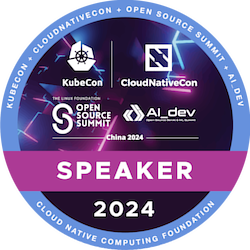
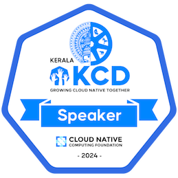

Hi! 

I'm Sreeram Venkitesh, a software engineer from Kerala, India. 

I'm an active contributor in the Kuberentes and the CNCF open source community. I started contributing to Kubernetes in 2022 and I've been part of the community across several areas now. Most recently, I'm leading the Kubernetes [v1.38 Release Team](https://github.com/kubernetes/sig-release/blob/master/releases/release-1.38/release-team.md). I have also contributed several features to Kubernetes mainly around pod and container lifecycle. I've also been helping to write and publish the [Last Week in Kubernetes Development newsletter](https://lwkd.info) for over three years now. See all of my contributions to Kubernetes [here](https://sreeram.xyz/k8s).

Currently I'm working at DigitalOcean as part of the [managed Kubernetes team (DOKS)](https://www.digitalocean.com/products/kubernetes). Previously I worked at [BigBinary](https://bigbinary.com) where I helped build [NeetoDeploy](https://neetodeploy.com), a cloud deployment Platform as a Service on top of Kubernetes. Since I left, NeetoDeploy has been made private for BigBinary's internal use only. I've been working at BigBinary since 2021 after I finished university and did various infrastructure and ops related work for three and a half years there.

I love giving [technical talks](https://sreeram.xyz/talks) at conferences. I find the entire process of researching and preparing a talk one of the best ways to learn about a topic in detail. So far I've given more than 20 talks in across 6 countries. Feel free to reach out to me if you have a talk idea you'd like us to present together!

I also enjoy blogging about the things I'm learning. You can read more about my work and my blogs in my [personal website](https://sreeram.xyz).

Last updated: October 6th, 2026
  
<!-- 

 -->

<!-- <table>
  <tr>
    <td>
        
    </td>
    <td>
        
    </td>
  </tr>
<!--     <tr>
        <td colspan="2">
        
        </td>
    </tr> -->
</table>
<!-- 

 
    
<!--  

<a href="https://twitter.com/fillerInk" target="_blank">
  

 -->

